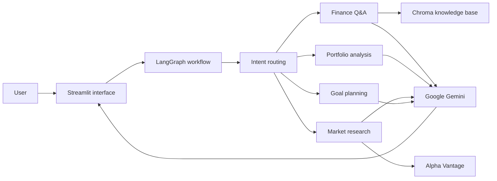

# Finnie — AI Finance Assistant

Finnie is an educational personal finance assistant built as a capstone MVP. It lets users explore finance concepts, discuss a portfolio, look up supported stock quotes, and work through savings goals in a conversational interface.

> **Education only:** Finnie's responses are AI-generated and may be inaccurate. They are not investment, financial, tax, or legal advice. Do not use them to make investment decisions.

## What Finnie can do

- **General discussion:** Answer educational personal finance and investing questions using a local knowledge base, with source links when relevant material is retrieved.
- **Portfolio analysis:** Discuss holdings provided in chat or uploaded in an `.xlsx`, `.png`, `.jpg`, or `.jpeg` file. Uploads are sent to Google Gemini for analysis; redact personal and account information first, and verify figures read from screenshots.
- **Market research:** Look up the latest available quote for a supported stock ticker using Alpha Vantage. Provider availability and rate limits may affect results; market answers show available quote timestamps.
- **Goal planning:** Discuss savings and budgeting goals using details the user chooses to share.
- **Conversation tabs:** Keep separate chats for Portfolio Analyze, Market Research, Goal Planning, and General Discussion during a browser session.

Finnie is a prototype. Generated answers can be incomplete, and data providers may be unavailable. Do not enter passwords, account numbers, government IDs, or other sensitive information.

## How it works



The knowledge base contains Markdown articles about investing, budgeting, banking, and Indian tax and economic concepts. Retrieved answers can show source titles and links. Market responses depend on the configured provider and its API allowance.

## Technology

- Python
- Streamlit
- LangGraph
- ChromaDB
- Google Gemini (`google-genai`)
- Alpha Vantage market data

## Run locally

### Requirements

- Python 3.13 or a compatible Python version
- A Google Gemini API key
- An Alpha Vantage API key for market quote requests

### Setup

From the repository root, create and activate a virtual environment, install dependencies, and create a local `.env` file from the example:

```powershell
py -3.13 -m venv .venv
.\.venv\Scripts\Activate.ps1
python -m pip install -r requirements.txt
Copy-Item .env.example .env
```

Add your API keys to `.env` using the variable names shown in `.env.example`. Keep `.env` private and never commit API keys.

### Prepare the knowledge base

Build or refresh the local Chroma index:

```powershell
python -m src.rag.ingest
```

### Start the app

```powershell
streamlit run src/frontend/app.py
```

Streamlit prints a local URL (usually `http://localhost:8501`) in the terminal.

## Repository map

| Path | Purpose |
|---|---|
| `src/frontend/app.py` | Streamlit interface and tab-specific chat sessions |
| `src/core/` | Shared workflow state, intent classification, routing, and LangGraph workflow |
| `src/agents/` | Finance Q&A, portfolio, market, goal, clarification, and out-of-scope handlers |
| `src/rag/` | Knowledge ingestion and retrieval |
| `knowledge_base/articles/` | Educational Markdown source material |
| `src/data/` | Market data client and local/sample data |
| `config.yaml` | Model, retrieval, market, and safety settings |
| `eval/` | Retrieval evaluation outputs |
| `tests/` | Project tests |

## Usage notes

- Ask one clear question at a time and provide only information needed for the task.
- In portfolio chat, provide approximate holdings and weights, or attach a supported workbook or screenshot.
- Market research currently focuses on one stock ticker per request; quote availability depends on Alpha Vantage.
- Goal planning is educational and depends on the assumptions and figures supplied in chat.
- Source links and retrieval distances help show what informed a knowledge-base response; they do not guarantee correctness.

## Project status

The repository contains a working Streamlit interface, a LangGraph routed workflow, a Chroma-backed finance knowledge base, and specialist handlers for finance Q&A, portfolios, markets, and goals. Some responses depend on external services and their availability. Review the repository's `readme.md`, source code, and evaluation files for the latest implementation details and known limitations.

## Documentation

- [Project README](https://github.com/MayankGaur05/finnie-ai-assistant/blob/main/readme.md)
- [Knowledge base articles](https://github.com/MayankGaur05/finnie-ai-assistant/tree/main/knowledge_base/articles)
- [Requirements](https://github.com/MayankGaur05/finnie-ai-assistant/blob/main/requirements.txt)

For capstone planning and assessment references, see the local `Docs/` folder if it is available in your checkout; those project-provided documents are not necessarily part of the public repository.
