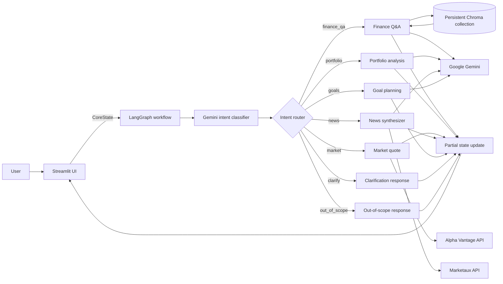

# Finnie Architecture

This document describes the architecture implemented in the repository. Finnie is an educational finance assistant built with Streamlit, LangGraph, Google Gemini, ChromaDB, and external market and news data providers.

> **Education only:** Finnie's AI-generated responses may be inaccurate. They are not investment, financial, tax, or legal advice.

## System overview



The graph classifies each request, routes it to **one** specialist or fallback node, and ends after that node returns its result. Specialist agents do not currently call one another.

## Request lifecycle

1. The Streamlit interface collects a message in one of its tabs and creates an initial state containing `user_input` and, for specialist tabs, `requested_intent`.
2. `classify_intent` asks Gemini to return one structured intent: `finance_qa`, `portfolio`, `market`, `news`, `goals`, `clarify`, or `out_of_scope`.
3. `route_intent` selects the corresponding LangGraph node. Specialist-tab selection can supply the requested intent, while an out-of-scope classification is preserved.
4. The node performs its task and returns only the fields it updates, such as `response`, `sources`, `tool_result`, `needs_clarification`, and `error`.
5. Streamlit renders the response and available source links, provider details, or clarification notice.

The graph is compiled in `src/core/workflow.py` as `chain`. It has no checkpointer configured. Streamlit keeps separate chat histories in browser-session state and includes recent user turns in a new request where useful; those histories are not durable server-side conversation records.

## Shared workflow state

`src/core/state.py` defines the `CoreState` TypedDict. `user_input` is the required starting field. Other fields are optional updates passed between workflow nodes:

| Field | Purpose |
|---|---|
| `intent`, `requested_intent` | Classifier result and optional UI-selected route |
| `entities` | Structured values such as a market ticker |
| `retrieved_context` | Chroma passages and metadata used by Finance Q&A |
| `sources` | Knowledge-base citations or news article citations |
| `tool_result` | Provider, retrieval, or workflow metadata for the UI |
| `response`, `needs_clarification`, `error` | User-facing result and status information |
| `portfolio_attachment_*` | Validated workbook text or image content supplied for portfolio analysis |

The state is an in-process workflow contract, not a database schema. Streamlit session state separately stores UI chat messages.

## Components

### Streamlit interface — `src/frontend/app.py`

The UI has five tabs: Portfolio Analyze, Market Research, News Synthesis, Goal Planning, and General Discussion. Each tab has its own chat history. The portfolio tab accepts `.xlsx`, `.png`, `.jpg`, and `.jpeg` uploads, performs basic validation, extracts bounded spreadsheet text, and sends user-provided portfolio material to the workflow. Uploaded information may be sent to Gemini; the UI advises users to redact personal details.

The interface displays education-only messaging, source links, article publisher/date metadata, market quote timestamps, clarification notices, and generic errors. It does not store uploaded data in a project database.

### Intent classification and routing — `src/core/`

- `intent_classifier.py` prompts Gemini for a JSON intent matching the supported intent set. In a specialist tab, the requested route is used unless Gemini classifies the message as out of scope.
- `router.py` maps the state intent to one graph branch and defaults missing or invalid values to clarification.
- `workflow.py` registers the classifier, specialist nodes, conditional routing, and terminal edges.
- `state.py` describes the state fields shared across nodes.
- `settings.py` reads LLM and retrieval configuration from `config.yaml`; `llm_provider.py` creates and caches the Google Gemini client using `GEMINI_API_KEY`.

### Finance Q&A and retrieval — `src/agents/finance_qa.py`, `src/rag/`

The knowledge base consists of Markdown articles under `knowledge_base/articles/`. Each article has YAML-style front matter used for its title, publisher, source URL, topic, and review date.

`src/rag/ingest.py` reads articles, chunks their content, and upserts those chunks and metadata into a persistent Chroma collection. Run ingestion again after adding or changing articles. At runtime, Finance Q&A queries the configured collection for up to `retrieval.top_k` passages, accepts passages at or below its 1.00 distance cutoff, groups citations by article, and asks Gemini to answer from the retrieved text. If no passages pass the cutoff, it returns a knowledge-base fallback rather than asking Gemini to answer from memory.

### Portfolio analysis — `src/agents/portfolio.py`

Portfolio analysis summarizes information explicitly supplied by the user, including uploaded workbook text or screenshot content prepared by the frontend. Gemini generates a descriptive response and can request missing holdings or weights. The current agent does not independently look up security data or perform deterministic portfolio valuation, correlation, or allocation calculations.

### Market research — `src/agents/market.py`

The market agent looks up a latest available quote for one stock symbol through Alpha Vantage. It reports the provider's quote date and retrieval timestamp, and it states that data may be delayed or end-of-day. The current workflow does not support index quotes or historical price series. The HTTP request, symbol resolution, and small in-process quote cache currently live in the agent; a separate market data client has not been implemented.

### News synthesis — `src/agents/news_synthesizer.py`, `src/data/news_client.py`

The news agent searches Marketaux's financial-news endpoint for English-language articles within the configured lookback period. The client normalizes each result to title, description, snippet, publisher, publication time, and URL; it deduplicates by URL and caps results at the configured maximum (currently three). It does not scrape publisher pages or retrieve full article text.

Gemini receives the user question and the returned article metadata, then writes a summary grounded in that material with `[Source N]` references. The source list and dates are returned separately for the UI. If Marketaux returns no articles or reports an error, the agent returns a fallback instead of generating a current-news answer from model memory.

### Goal planning — `src/agents/goals.py`

The goals agent provides general savings and budgeting guidance from details in the request, explains assumptions, and asks for missing information. It is prompt-based and does not currently run a separate projection or financial calculation engine.

### Clarification and out-of-scope handling

`src/agents/clarify.py` and `src/agents/out_of_scope.py` return deterministic fallback messages. They do not call an external data provider or Gemini.

## External services and configuration

| Service | Use | Configuration |
|---|---|---|
| Google Gemini | Intent classification and generated explanations/summaries | `llm` in `config.yaml`; `GEMINI_API_KEY` in local environment |
| ChromaDB | Persistent vector collection for educational articles | `retrieval` in `config.yaml` |
| Alpha Vantage | Latest available single-stock quote | `market_data` in `config.yaml`; `ALPHA_VANTAGE_API_KEY` |
| Marketaux | Recent financial-news article metadata | `news_data` in `config.yaml`; `MARKETAUX_API_TOKEN` (the client also accepts `MARKETAUX_API_KEY`) |

Keep real credentials in a local `.env` file or environment variables. `.env.example` contains variable names only. Do not commit keys or paste them into logs, issue reports, or chat.

## Repository map

```text
src/
  agents/       Specialist and fallback workflow nodes
  core/         State, settings, Gemini client, classifier, router, graph
  data/         External data clients
  frontend/     Streamlit interface
  rag/          Markdown ingestion and Chroma retrieval
knowledge_base/
  articles/     Educational Markdown content
sample_data/    Sample portfolio workbooks
eval/           Retrieval evaluation outputs
tests/          Project tests
config.yaml     Application, LLM, retrieval, market, and news settings
```

## Running the application

From the repository root with the virtual environment active:

```powershell
python -m pip install -r requirements.txt
python -m src.rag.ingest
streamlit run src/frontend/app.py
```

Ingestion is needed when the knowledge-base articles change. Market and news requests also require their respective API keys; Gemini-backed workflow paths require `GEMINI_API_KEY`.

## Current boundaries

- The system is educational and does not make individualized investment, tax, legal, or buy/sell recommendations.
- The router selects a single branch per request; agents are not collaborating in a multi-step or supervisor workflow.
- Conversation context is assembled by the frontend and is limited to the current Streamlit session.
- Finance Q&A depends on knowledge-base coverage and the configured retrieval cutoff.
- Portfolio and goals responses are generated by Gemini from user-provided details; these paths do not have deterministic financial calculation services.
- Market and news results depend on third-party provider coverage, credentials, network access, and plan limits.
- News summaries use Marketaux metadata/snippets, not complete publisher articles. The UI should link users to original articles for full context.
