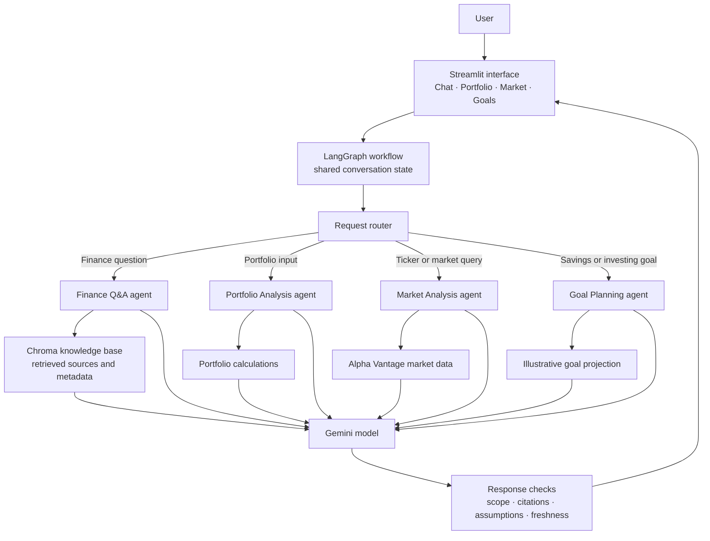

# Finnie — AI Finance Assistant

> **Project planning brief · Draft**  
> A two-week capstone to build an approachable AI assistant for financial education.

## Project overview

Finnie is intended to help beginner investors understand personal-finance and investing concepts through clear, conversational explanations. The project brief calls for specialized agents, retrieval from trusted educational sources, market data, portfolio analysis, goal planning, and a simple web interface.

Finnie should be designed as an **educational tool**, with transparent sources and clear limits. It should not present its responses as personalized professional financial advice.

## MVP planning brief

The answers below define the proposed first version of Finnie and keep the scope achievable within the two-week capstone timeline.

### 1. Audience and problem

**Who is Finnie for, and what beginner problem will it solve?**

Finnie is for people who are new to investing and personal finance. It will help them understand unfamiliar financial terms, compare common investment concepts, and think through basic goals without feeling overwhelmed by jargon. Finnie is an educational assistant: it explains options and trade-offs, but it does not make investment decisions or replace a qualified financial professional.

### 2. First-version agents

**Which four agents belong in the first working version, and what specific job will each handle?**

| Agent | Job in the MVP |
|---|---|
| Finance Q&A | Answer general finance and investing questions in beginner-friendly language, using the knowledge base and showing relevant sources. |
| Portfolio Analysis | Summarize a user-provided or sample portfolio with total value, allocation percentages, and basic diversification observations. Explain the limits of these metrics. |
| Market Analysis | Retrieve and explain basic market information for a requested ticker or market index, including the data timestamp and a reminder that short-term movement is uncertain. |
| Goal Planning | Help users describe a savings or investing goal, time horizon, and stated risk comfort; provide simple illustrative projections and explain the assumptions. |

The News Synthesizer and Tax Education agents are candidates for later work if the four-agent MVP is stable.

## Proposed architecture

This design keeps the user interface, workflow, specialist tasks, and external data sources as separate parts. The workflow routes each request to the relevant specialist and carries shared conversation context through the response.

The workflow state should carry the current question, conversation history, selected agent, relevant user-provided inputs, retrieved source references, data timestamps, and any fallback or safety notices. Portfolio totals and goal projections should be calculated from explicit inputs and assumptions; the language model should explain the results rather than invent the arithmetic. The Q&A agent should include retrieved source details in its answer. The response checks should keep education-only boundaries visible and flag stale or unavailable market data.

## Provisional technology choices

These are the proposed choices for the MVP. They follow the project brief and favor a local, demonstrable application; we can revisit them if setup constraints arise.

| Area | Proposed choice | Reason |
|---|---|---|
| Language | Python | Fits the Python-focused examples and integrates with the proposed AI and data tools. |
| Agent workflow | LangGraph | The project milestones recommend it for routing, shared state, and controlled multi-agent workflows. |
| Language model | Google Gemini API | The milestones recommend Gemini for development. Select a currently available Flash model and confirm the API interface supported by the LangGraph integration when implementation begins; Google currently recommends its Interactions API for new projects. |
| Knowledge retrieval | Chroma, local development mode | Supports document storage, metadata, and similarity search, which fit a small, category-filtered educational knowledge base. |
| Market data | Alpha Vantage API | The project brief lists it as a market-data option and its API documentation covers stock time-series data. Validate the available plan and request limits before relying on it in the demo. |
| User interface | Streamlit | Suits the planned chat and data views, including interactive charts and a multi-page or tabbed app. |
| Conversation state | LangGraph workflow state, with Streamlit session state for the local UI session | Keeps request context available across workflow steps and user turns in the prototype. |

Keep API keys in local environment configuration and out of Git. These choices are provisional until the project environment and service access are confirmed.

### Official technology references

- [LangGraph documentation](https://langchain-ai.github.io/langgraph/reference/) — stateful workflow and agent orchestration.
- [Google Gemini API documentation](https://ai.google.dev/gemini-api/docs) — current API guidance and model options.
- [Chroma documentation](https://docs.trychroma.com/) — document storage, embeddings, vector search, and metadata filtering.
- [Alpha Vantage API documentation](https://www.alphavantage.co/documentation/) — market-data endpoints.
- [Streamlit documentation](https://docs.streamlit.io/get-started) — app, charts, layout, and caching fundamentals.

### 3. Boundaries and fallback behavior

**What should Finnie do when a question is outside an agent’s scope or market data is unavailable?**

If a question is outside its scope, Finnie should say so plainly, avoid guessing, and offer a relevant general explanation or suggest an appropriate professional resource. It should not provide personalized buy, sell, or tax instructions. If live market data is unavailable, Finnie should explain the issue and show cached data only when available, with its timestamp and a clear stale-data label. If no reliable data is available, it should say so instead of presenting invented figures.

### 4. Trusted information and transparency

**Which sources will support educational answers? How will Finnie show citations and its education-only disclaimer?**

The initial knowledge base will prioritize reliable, beginner-friendly educational material from **SEC Investor.gov**, **FINRA**, and the **Bogleheads Wiki**. Investopedia may be used as a supplementary source for plain-language definitions. Each knowledge item should record its title, publisher, URL, topic, and review date. Answers grounded in retrieved material should show source titles and links near the relevant explanation. Finnie should display an education-only disclaimer in the interface and remind users that it does not provide personalized financial, legal, or tax advice.

### 5. Demo success

**What should a successful demo user be able to do from start to finish?**

In the demo, a beginner asks Finnie to explain a basic investing concept and receives a clear answer with sources. The user then reviews a sample portfolio and sees its allocation and diversification observations, asks for current information about a ticker and sees the data timestamp, and describes a savings goal with a time horizon and risk comfort to receive an illustrative projection with assumptions. The demo should also show Finnie handling a follow-up question with context and responding safely when data is unavailable or a request is outside its educational scope.

## Project guardrails

- Keep explanations beginner-friendly and define financial terms in plain language.
- Show where educational claims come from, and make source attribution visible.
- Distinguish general education from financial advice.
- Make data freshness clear; explain when live market data cannot be retrieved.
- Prioritize a reliable, well-explained core experience before optional stretch features.

## Two-week delivery outline

| Sprint | Focus | Reviewable outcome |
|---|---|---|
| **1 · Scope and foundations** | Confirm the MVP, agent responsibilities, architecture, and sources. | Completed planning brief and architecture sketch. |
| **2 · Core intelligence** | Implement and connect the core agents, routing, retrieval, conversation state, and fallbacks. | A working end-to-end assistant flow. |
| **3 · Interface and quality** | Build the main user views and validate key user journeys. | A usable chat, portfolio, market, and goals experience. |
| **4 · Submission readiness** | Fix defects, complete documentation, and prepare the demo. Add stretch work only if the core is stable. | A polished prototype and 5–10 minute demonstration. |

## Success criteria

The MVP should demonstrate a coherent user journey that includes:

1. Asking a beginner finance question and receiving a sourced explanation.
2. Reviewing a sample portfolio with understandable metrics.
3. Looking up market information with a visible freshness or fallback message.
4. Exploring a financial goal while considering the user’s stated risk appetite.
5. Continuing a conversation with relevant context preserved.

The project brief describes six agents, a 50–100 article knowledge base, and 80%+ test coverage as objectives. For a two-week MVP, the milestone guidance recommends prioritizing four or five well-defined agents over rushing all six. Treat the full article count, higher test coverage, and MCP integration as stretch goals after the core journey works.

## Assessment focus

The grading rubric assigns **40%** to technical implementation, **25%** to user experience, **20%** to financial domain knowledge, and **15%** to code quality and documentation. It separately lists MCP as a five-point rubric item, although the project brief calls MCP optional. The build plan should therefore protect time for the core agent workflow, useful interface, credible educational content, and submission documentation before taking on MCP.

## Reference documents

- `Docs/AIFinanceAssistant-ProblemStatement.docx` — business use case, architecture, deliverables, and evaluation criteria.
- `Docs/AIFinanceAssistant-ProjectMilestones.docx` — suggested implementation sequence and practical guidance.
- `Docs/GradingRubric_AIFinanceAssistant.xlsx` — detailed assessment levels and weights.
